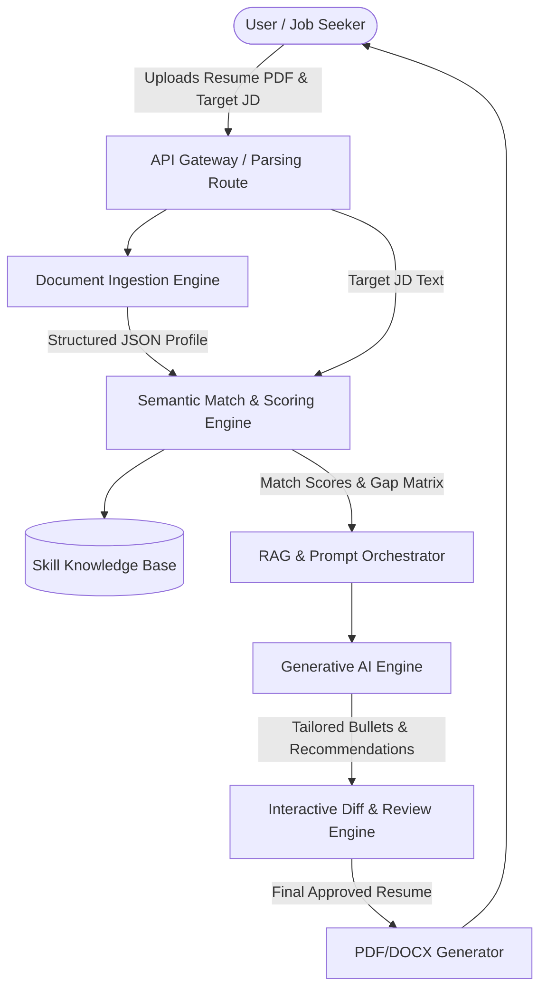
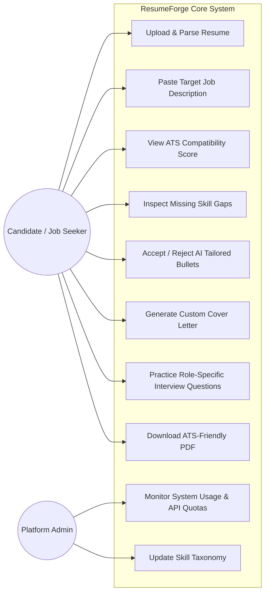
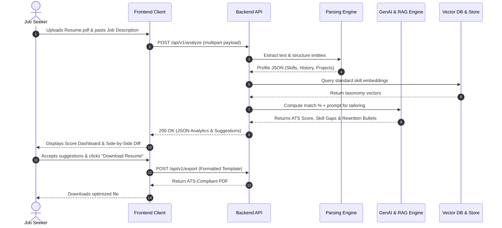

# ResumeForge: System Architecture & Design Diagrams

## 1. High-Level 5-Tier Architecture
The ResumeForge platform is structured into five distinct operational tiers:

```
[ Tier 1: User / Presentation Layer ]
  ├── Web Browser (HTML5 / Tailwind CSS / Vanilla JS)
  ├── Resume PDF/Docx Uploader & Dynamic Markdown Viewer
  └── Real-Time Career Chat & Diff Reviewer
             │ (HTTPS / REST API)
             ▼
[ Tier 2: Application / API Gateway Layer ]
  ├── Python 3.10+ FastAPI / Flask Web Framework
  ├── Auth Middleware (JWT & OAuth2)
  └── Rate Limiting & Validation Pipelines
             │
             ▼
[ Tier 3: Core AI & Processing Services ]
  ├── Parser Engine (pdfplumber, regex tokenizers)
  ├── Semantic Matching & Scoring (Sentence-Transformers)
  ├── RAG Pipeline & Prompt Orchestrator (LangChain)
  └── LLM Generation Engine (Resume Tailoring, Cover Letters, Q&A)
             │
             ▼
[ Tier 4: Data & Knowledge Persistence Layer ]
  ├── Relational DB (PostgreSQL / SQLite for User Data & History)
  ├── Vector Store (FAISS / ChromaDB for Skill Ontologies & Embeddings)
  └── Object Storage (AWS S3 / Firebase for Stored Resumes)
             │
             ▼
[ Tier 5: Administration & Monitoring ]
  ├── Admin Dashboard & Model Usage Analytics
  └── Continuous Feedback & Evaluation Loop
```

---

## 2. Comprehensive Mermaid UML Diagrams

### A. Data Flow Diagram (DFD Level 1)


### B. Use Case Diagram


### C. Sequence Diagram: Resume Tailoring & Score Workflow


---

## 3. Entity-Relationship (ER) Schema

```
+--------------------+       +----------------------+       +-----------------------+
|       USERS        |       |       RESUMES        |       |       JOB_POSTS       |
+--------------------+       +----------------------+       +-----------------------+
| id (PK, UUID)      |1     *| id (PK, UUID)        |       | id (PK, UUID)         |
| email (VARCHAR)    |-------| user_id (FK)         |       | user_id (FK)          |
| password_hash      |       | file_path (VARCHAR)  |       | title (VARCHAR)       |
| full_name (VARCHAR)|       | parsed_data (JSONB)  |       | company (VARCHAR)     |
| created_at (TS)    |       | ats_score (INT)      |       | jd_text (TEXT)        |
+--------------------+       | created_at (TS)      |       | required_skills(JSONB)|
                             +----------------------+       +-----------------------+
                                        |                               |
                                        +---------------+---------------+
                                                        |
                                                        ▼
                                            +-----------------------+
                                            |     EVALUATIONS       |
                                            +-----------------------+
                                            | id (PK, UUID)         |
                                            | resume_id (FK)        |
                                            | job_id (FK)           |
                                            | score (FLOAT)         |
                                            | skill_gaps (JSONB)    |
                                            | suggestions (JSONB)   |
                                            | created_at (TS)       |
                                            +-----------------------+
```
